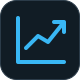
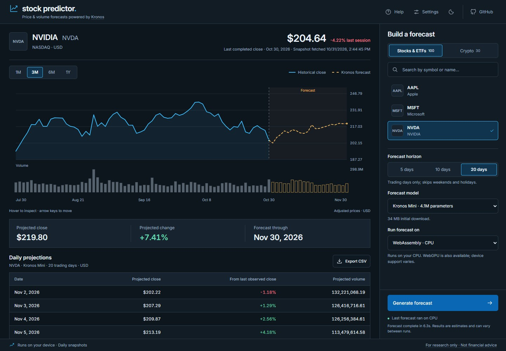
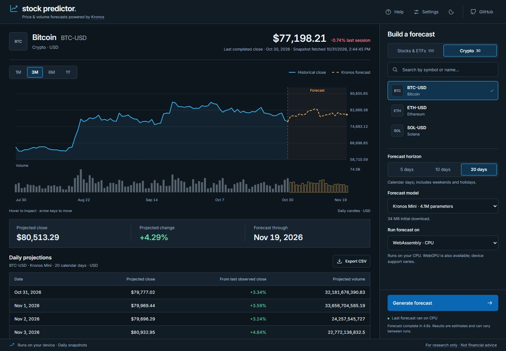
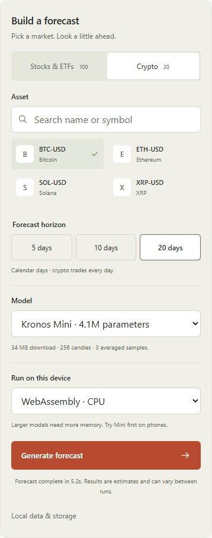
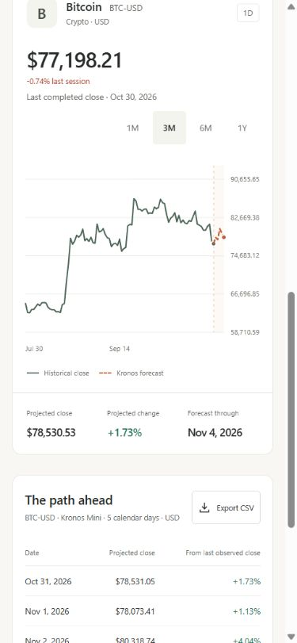

<div align="center">
  
  <h1>Stock Predictor</h1>
  <p><strong>A little more perspective on the markets.</strong></p>
  <p>Explore stocks, ETFs and crypto with real market history<br>and local forecasts powered by <a href="https://github.com/shiyu-coder/Kronos">Kronos</a>.</p>
  <p>
    <a href="https://www.python.org/downloads/"></a>
    <a href="LICENSE"></a>
    <a href="https://github.com/shiyu-coder/Kronos"></a>
  </p>
  <p><a href="#quick-start">Quick start</a> · <a href="#run-with-docker">Docker</a> · <a href="#choose-your-model">Models</a> · <a href="docs/deployment.md">Deployment</a> · <a href="CONTRIBUTING.md">Contributing</a></p>
</div>



Stock Predictor is a small, self-hostable research app: pick an asset, choose a Kronos model and explore its projected daily closes. A single Python service serves the interface and runs inference on your machine. No frontend build step or paid data API key is required.

## Made for exploring

- **130 curated assets.** Search 80 US-listed stocks, 20 ETFs and 30 USD crypto pairs.
- **Three real models.** Switch between Kronos Mini, Small and Base, with their matching tokenizers.
- **Readable forecasts.** Observed prices stay solid; projected prices are dashed. Dates and model provenance stay visible.
- **Useful exports.** Inspect the projected closes or download a CSV with the selected model ID.
- **Local first.** Run on CPU, optionally use NVIDIA CUDA, or package the same application with Docker.
- **Honest failure states.** Data and model errors are surfaced. The production app has no invented-price or simulated-inference fallback.

## Quick start

Clone or download this repository and open a terminal in its root folder. Choose Docker or a local Python installation.

### Run with Docker

Install Docker with Compose support and start the Docker engine. On Windows or macOS, Docker Desktop provides both; use Linux containers on Windows. Python and Node do not need to be installed on the host.

Build the image and start the app in the background:

```sh
docker compose up --build -d
```

Open **[localhost:8000](http://127.0.0.1:8000)**. The first image build installs the CPU dependencies. When you generate a forecast, the selected model and tokenizer download on first use; allow a few minutes and keep internet access available for downloads and market history.

Check the container status or follow its logs:

```sh
docker compose ps
docker compose logs -f stock-predictor
```

Press `Ctrl+C` to leave the log view; the app keeps running. To stop and remove the container:

```sh
docker compose down
```

Start it again with `docker compose up -d`. After updating the source, rebuild with `docker compose up --build -d`.

Downloaded models and market history persist in the `model-cache` named volume, mounted at `/data/cache`. `docker compose down` preserves this cache. Jobs are held in memory and disappear when the app restarts.

If port 8000 is already in use, create or edit `.env` in the repository root, set `KRONOS_PORT=8001`, and rerun the startup command. Then open [localhost:8001](http://127.0.0.1:8001). Compose binds the published port to `127.0.0.1` by default. The included image runs on **CPU**; see the [deployment guide](docs/deployment.md) for remote access, authentication and GPU considerations.

### Run with Python

Install **Python 3.12**, then run the command for your platform from the repository root.

**Windows · PowerShell**

```powershell
.\scripts\start.ps1 -Setup
```

**macOS / Linux**

```sh
sh scripts/start.sh --setup
```

Open **[localhost:8000](http://127.0.0.1:8000)**. Setup creates a project-local environment and installs CPU PyTorch. The first forecast with each model downloads its weights and tokenizer from Hugging Face; subsequent runs reuse the cache. Installation and first inference can take a few minutes.

For later starts, omit `-Setup` / `--setup`:

```powershell
.\scripts\start.ps1
```

```sh
sh scripts/start.sh
```

If PowerShell blocks scripts or your platform has no CPU-index wheel, use the [manual installation steps](docs/troubleshooting.md#installation). Python is the only runtime needed for the website; Node is optional for development tests.

## From history to a forecast

1. Choose **Stocks & ETFs** or **Crypto**, then search by symbol or name.
2. Pick a **5, 10 or 20-day** horizon and a model.
3. Generate a forecast. Review the chart, projected closes and model ID, then export if useful.

Stocks and ETFs advance by US trading sessions; crypto advances by UTC calendar days. History uses completed daily candles, with the latest observation date shown in the interface. Prices are **daily observations, not live quotes**. Stock history is adjusted.



### A focused market inventory

| Market | Assets | Examples |
| :--- | ---: | :--- |
| US-listed stocks | 80 | AAPL, MSFT, NVDA, AMZN |
| US-listed ETFs | 20 | SPY, QQQ, VTI, GLD |
| USD crypto pairs | 30 | BTC-USD, ETH-USD, SOL-USD, LINK-USD |

All assets use USD quotes. ETFs span equities, sectors, bonds and metals. The catalog is curated: arbitrary tickers and international exchange calendars are outside this version. [Recheck provider availability](docs/verification.md#live-catalog-check) when extending it.

## Choose your model

| Model | Parameters | Tokenizer | Upstream context limit |
| :--- | ---: | :--- | ---: |
| [Kronos Mini](https://huggingface.co/NeoQuasar/Kronos-mini) | 4.1M | Tokenizer-2k | 2,048 |
| [Kronos Small](https://huggingface.co/NeoQuasar/Kronos-small) · default | 24.7M | Tokenizer-base | 512 |
| [Kronos Base](https://huggingface.co/NeoQuasar/Kronos-base) | 102.3M | Tokenizer-base | 512 |

Stock Predictor uses up to **256 completed candles** and averages **three samples**, with temperature `1.0` and top-p `0.9`. Only one predictor stays loaded at a time. Larger models use more memory and do not guarantee better predictions. Results are stochastic; rerunning a forecast may change it.

<details>
<summary><strong>A compact workspace on mobile, too</strong></summary>
<br>


</details>

## Your machine. Your server.

Defaults work locally. To customize them, copy [`.env.example`](.env.example) to `.env`:

```dotenv
KRONOS_DEVICE=auto
KRONOS_MODEL=NeoQuasar/Kronos-small
KRONOS_PORT=8000
```

The `KRONOS_*` names are retained for compatibility. Read the [configuration guide](docs/configuration.md) for GPU setup, cache paths, model overrides and the optional API token.

The [Docker quick start](#run-with-docker) packages the same application with CPU dependencies and a persistent model cache. For remote access, use an SSH tunnel or a TLS reverse proxy and configure an access token. Keep one application worker: models and forecast jobs live in one process. See [deployment and runtime limits](docs/deployment.md).

**Market-data rights matter.** The default Yahoo Finance / yfinance integration is intended for personal research. Public or commercial hosting needs a provider with appropriate rights. The code license does not grant rights to redistribute market data or model weights. See [third-party notices](THIRD_PARTY_NOTICES.md).

## Under the hood

**FastAPI + PyTorch + vanilla HTML/CSS/JavaScript.** No Node runtime in production, no external chart service, and no model weights committed to the repository.

| Guide | What you will find |
| :--- | :--- |
| [Architecture & API](docs/architecture.md) | Data flow, module boundaries, endpoints and upstream provenance |
| [Configuration](docs/configuration.md) | Environment settings, model selection and CUDA |
| [Deployment](docs/deployment.md) | Docker, remote access, cache persistence and process limits |
| [Troubleshooting](docs/troubleshooting.md) | Installation, downloads, provider errors and expired jobs |
| [Verification](docs/verification.md) | Automated checks, real inference checks and tested scope |
| [Contributing](CONTRIBUTING.md) | Development setup and deterministic tests |
| [Security](SECURITY.md) | Deployment scope and responsible reporting |

The automated suite runs without model downloads or live market requests:

```sh
python -m pip install -r requirements-dev.txt
python -m pytest -q
node --test tests/frontend.test.mjs
```

Run these inside your Python 3.12 environment. GitHub Actions is configured for Python tests on Windows and Ubuntu, plus Node 24 frontend tests.

## Credit & license

Stock Predictor is an independent interface built around **[Kronos by ShiYu and contributors](https://github.com/shiyu-coder/Kronos)**. The upstream model source is vendored with its original MIT license; weights are fetched separately from the [NeoQuasar repositories](https://huggingface.co/NeoQuasar). Market history is supplied through [yfinance](https://ranaroussi.github.io/yfinance/).

Application code is available under the [MIT license](LICENSE). Upstream source, weights, data and dependencies retain their own terms; see [THIRD_PARTY_NOTICES.md](THIRD_PARTY_NOTICES.md).

**For research and exploration.** Forecasts are estimates, not financial advice. Stock Predictor provides no accuracy guarantee, calibrated confidence interval or trading execution.
