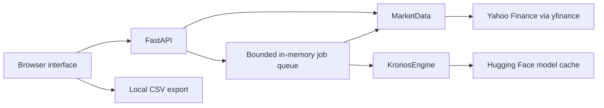

# Architecture & API

Stock Predictor is a single-process application. FastAPI serves static browser assets, fetches market history and schedules Kronos inference. Production has no simulated-data or simulated-prediction fallback.



## Source map

```text
app/
  main.py           HTTP routes, validation and optional API authentication
  assets.py         Curated, typed asset catalog
  market.py         Provider adapter, normalization and calendar rules
  model_specs.py    Model profiles and matching tokenizers
  engine.py         Lazy model loading and inference
  jobs.py           Serialized jobs, queue bounds and expiration
  static/           HTML, CSS, JavaScript and SVG chart
scripts/            Startup helpers and live catalog verification
tests/              Deterministic Python and frontend tests
vendor/kronos/      Pinned upstream model source and original license
```

## History and forecast rules

- The curated catalog accepts supported symbols only: 80 US-listed equities, 20 US-listed ETFs and 30 USD crypto pairs.
- History consists of completed daily OHLCV candles. Stocks use adjusted prices; future US stock/ETF dates respect the XNYS session calendar, including holidays and early closes. Crypto dates use UTC calendar days.
- Inference uses up to 256 candles, averages three samples, and uses temperature 1.0 and top-p 0.9. Mini's tokenizer differs from Small/Base.
- The browser distinguishes observed and forecast prices and clears stale results when inputs change. Jobs retain the model selected at submission; results and CSV exports include its identifier.
- The process keeps one predictor in memory and serializes inference. The queue allows at most three pending/running jobs. Completed records expire after 30 minutes; the retained record count is bounded at 100.

To replace the market-data source, implement the normalized OHLCV contract at `MarketData._load` in `app/market.py`. Preserve completed-candle filtering, timestamps, calendar rules and explicit failure handling. The frontend and model integration do not need provider-specific changes.

## API

All API responses use `Cache-Control: no-store`. If configured, the same bearer token is required for every route below. Interactive API docs are disabled.

| Method | Path | Purpose |
| :--- | :--- | :--- |
| GET | `/api/health` | Service and model status; authentication configuration |
| GET | `/api/assets` | Supported assets |
| GET | `/api/models` | Model profiles and default selection |
| GET | `/api/history?symbol=AAPL` | Completed price history |
| POST | `/api/forecasts` | Submit a job; returns HTTP 202 |
| GET | `/api/forecasts/{job_id}` | Poll job state and result |

Example forecast body:

```json
{"symbol": "AAPL", "horizon": 10, "model": "small"}
```

`horizon` must be an integer: 5, 10 or 20. `model` may be `mini`, `small`, `base`, or `configured` when the server offers a custom profile; omitting it selects the server default. Job states are `queued`, `running`, `complete` or `failed`.

Invalid selections return 422. A full queue returns 429 with `Retry-After: 10`. Unknown/expired jobs return 404. History provider errors return 503; inference failures are recorded on the job and displayed by the interface.

## Upstream provenance

Only the model source needed for inference is vendored from [shiyu-coder/Kronos](https://github.com/shiyu-coder/Kronos), pinned to commit `67b630e67f6a18c9e9be918d9b4337c960db1e9a`. It is included unmodified with its original MIT license. Model weights are downloaded separately. See [third-party notices](../THIRD_PARTY_NOTICES.md) for sources and terms.
